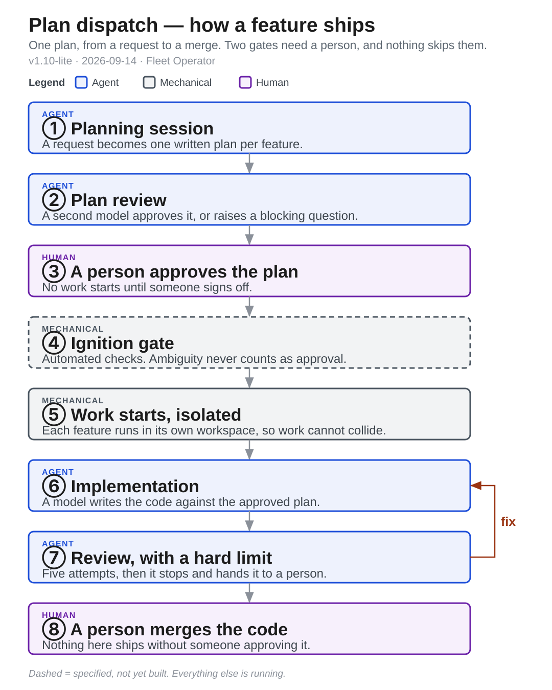

# eunomia

Fleet control plane for multi-agent workstreams: leases on shared state, an
append-only event log, session heartbeats, and the controls-registry lint.
Named for the goddess of good order.

It came out of a postmortem: thirteen coding-agent sessions running at once, and
every failure was between lanes, not inside them. Two sessions editing the same
file, a reviewer reading another session's branch, a push landing after an
approval. eunomia is the set of controls that closed those gaps, one at a time.

  

The figure shows the default, a `critical` repo, where a person merges every
pull request. On a repo the owner marks `autonomous`, the merged plan is the
human approval: a program merges the code once two independent reviewers have
approved it and CI is green
([ADR-0019](docs/adr/0019-on-an-autonomous-repo-the-plan-is-the-human-approval.md)).
The reference figure, with the test lanes and every gate, is in
[`docs/diagrams/`](docs/diagrams/).

## Start here

There is a lot in this repo. Three files will tell you whether the rest is worth
your time:

1. **`plans/0000-template.md`** — the plan template. Every piece of work starts as
   one of these, and merging it is the go signal. If the idea of writing down
   what *not* to touch before an agent starts doesn't appeal, stop here.
2. **`SPEC.md`** — the ledger, lease and event contracts: how sessions claim work
   and what gets recorded when they do.
3. **`docs/adr/0006-blackbox-test-lanes.md`** — why the tests are written by a
   model that never sees the code. The other ADRs read the same way: the
   decision, then the reasons.

## What's in it

- `docs/feature-plans.md` — the unit of delegated work: a plan states what to build
  **and which local patterns don't apply**, which is what makes one session per
  feature safe (`bin/fleet-plan`)
- `docs/plan-dispatch.md` — how a merged plan becomes an implementation PR, a
  review, and a human merge
- `docs/adr/` — the decisions, with the reasons they were made
- `docs/fleet-history.md` — fleet history derived from Claude Code transcripts,
  with no opt-in (`bin/fleet-collect`, `bin/fleet-snapshot`)

Runtime state lives in `~/dev/.fleet/` and is never committed. This repo holds
the code, the schemas, and the hooks.

## Status

This is a cut of a private repo that runs a real fleet every day. It is shaped
by that fleet: macOS hosts under launchd, a self-hosted Forgejo as the forge,
Forgejo Actions on a self-hosted runner for CI. A GitHub forge backend exists
in `bin/fleetforge.py`, but it has only been tested against recorded response
shapes, never a live GitHub API.

It is not yet something you install in thirty minutes. Expect to read the
SPEC and the ADRs before running anything.

## Names in this cut

The fleet's hosts and accounts were replaced with role names:

| Name here | Role |
|---|---|
| `opshost` | the operator's machine; holds the ledger |
| `vaulthost` | runs the secrets vault (`keyvault`, OpenBao) |
| `cihost` | CI runner and model execution |
| `edgehost` | the DMZ host for webhooks and the phone-facing proxy |
| `gpuhost` | the GPU machine that serves local models |
| `forge.example` | the Forgejo server |
| `implbot` | the forge account that authors implementation PRs |
| `revbot` | the forge account that posts reviews |
| `rev2bot` | the forge account of the second reviewer |
| `mergebot` | the forge account that merges on autonomous repos; a program, not a model |
| `recordbot` | the forge account that writes a change record for every merge |
| `intakebot` | the forge account that files plans from intake |
| `hosttools` | a sibling repo of host-side helper scripts |
| `recordstore` | the sibling repo those change records are written to |

A few other hosts, services and sibling repos were renamed the same way where
they are mentioned (`nashost`, `tunnelhost`, `scanhost`, `docsite`, `intakeapp`,
`deskapp`, `evalrig`, `deployplane`, `arenarepo`, `modeltiers`, `trainrig`,
`evalset`).

The work history (`plans/`, the roadmap) and the fleet's recorded measurements
(`docs/measurements/`, `docs/ci-evidence/`) are not included, so some references
in the docs point at files that are not here.

## License

Apache-2.0. See `LICENSE`.
